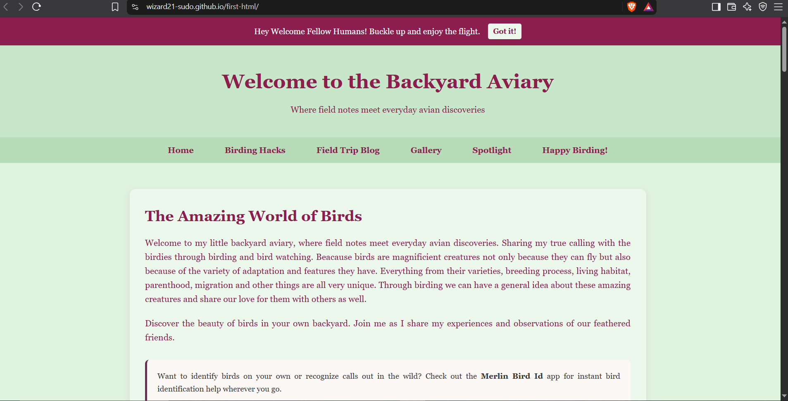

# The Backyard Aviary 

 Welcome to **The backyard aviary**! This is a personal web project I made as a little journal to log in my local birdwatching experiences, share practical field notes, and celebrate the beauty of the wild little birds found in the nature around us.
 This website was built completely from scratch using the standard HTML5 and CSS3 while fully focusing on on an engaging reading experience without relying on heavy frameworks.

 

## What's Inside the Site

 - **Greeting Banner:** A welcome announcement banner for the fellow visitors.
 - **Birding Hacks:** This section contains lighthearted tips for birdwatching in my style.
 - **Field Trip Blog:** A featured story section that documents my fist bird walk at the Mooncanal, Prayagraj.
 - **The Backyard Gallery:** A local image gallery grid showcasing a wide collection of my observed bird sightings.
 - **Featured Bird Spotlight:** An interactive CSS-only flip card feature using radio buttons. Visitors can switch between  birds and get a surprise quick fun facts.
 - **Closing Note:** This is a simple heartfelt sign-off to encourage readers to keep observing our avian friends in their own backyard.

## External Resources

 To help fellow birdwatcher enthusiasts dive deeper into birdwatching, I added two trusted external platforms on my site:
 - **Merlin Bird ID:** It is a helpful tool to get assistance for identification of birds in the field for beginners.
 - **Ataavi:** Featured in the blog section to connect readers in India with local bird walks and community guidance.

## Built with

 - **HTML5:** Used various tags to give structure to the website.
 - **CSS3:** With the help of this I added my custom page layout design using Flexbox and CSS Grid.
 - **Responsive Design:** Media queries ensuring smooth rendering across different devices.
 - **Interactive CSS Features:** 
 1. Radio-button for switching potlight cards without JavaScript.
 2. 3D CSS transform ( perspective, rotateY ) for interactive card flip.
 3. Sticky positioning for top navigation elements.

## Live Testing

 You can view and test my live website directly through here -
 https://wizard21-sudo.github.io/first-html/ 

## Credits 

 - **Photography:** Special thanks to Abhishek Bhatt, a fellow birdwatcher for generously sharing some of his original bird photographs he took during our walk which I used in the gallery and spotlight sections along with others that I took myself.
 - **Guidance:** Built with guidance from the Stardance project resources.

## AI Usage Disclaimer
 I used AI tools strictly as a brainstorming assistant - specifically for fixing the CSS transitions for the flip-card thing. 
 All the HTML structures, CSS styling rules, Media selection, original blog content were personally assisted only by me <3

 